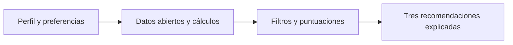
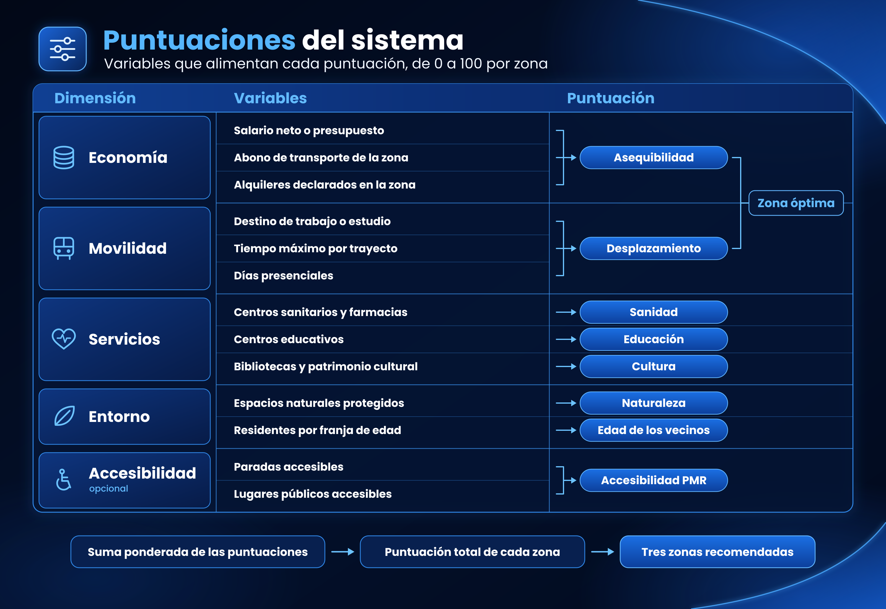
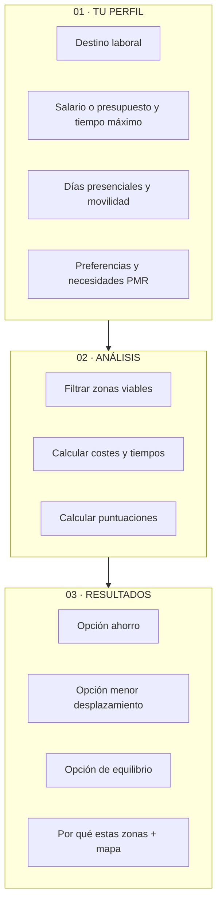
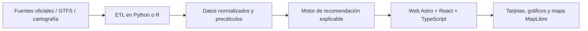

# MADRID A TU MEDIDA

### ¿Y si pudieras descubrir dónde vivir según cómo quieres vivir?

**Sistema de recomendación residencial personalizado · DATAMAD 2026**

*Una propuesta para transformar datos abiertos de la Comunidad de Madrid en decisiones residenciales comprensibles, adaptadas y justificadas.*

**Estado:** propuesta de proyecto · **Ámbito:** Comunidad de Madrid · **Formato previsto:** aplicación web interactiva

---

## El problema

Elegir dónde vivir no depende únicamente del precio del alquiler. También importan las horas que dedicamos a desplazarnos, la accesibilidad a servicios, el entorno y nuestras necesidades particulares. Sin embargo, esta información suele estar dispersa entre distintas fuentes y resulta difícil de comparar.

**Madrid a tu medida** propone invertir el proceso habitual de búsqueda: en lugar de pedir a una persona que elija primero un municipio, **el sistema le recomienda zonas residenciales a partir de su perfil y sus prioridades**.

## ¿Cómo funciona?

**01 · Cuéntanos cómo vives** → **02 · Analizamos las alternativas** → **03 · Descubre tus tres zonas recomendadas**

### Datos de entrada y resultados

Cada variable alimenta una puntuación de 0 a 100 por zona. La suma ponderada de las puntuaciones ordena las zonas y da lugar a las tres recomendaciones.

La aplicación devuelve:

Tres zonas recomendadas, una por perfil, con su puntuación total y el desglose por criterio.
El alquiler máximo asumible en cada zona, junto a una referencia histórica: «Con tu salario puedes asumir hasta X €/mes en esta zona. En 2024, la mitad de los alquileres aquí estaba entre A y B € (mediana M).»
Minutos por trayecto, horas mensuales de transporte y coste del abono.
Un mapa comparativo de las tres zonas.

El dato económico por defecto es el salario neto mensual. A partir de él la aplicación calcula el gasto máximo asumible en alquiler y transporte (35 % del salario). Quien prefiera hacer sus propias cuentas (por ejemplo, una pareja que suma dos ingresos) puede saltar este paso e indicar directamente su presupuesto mensual.

## Experiencia de usuario prevista

| Pantalla | Objetivo | Interacción principal |
|---|---|---|
| **1. Tu perfil** | Conocer necesidades y límites | Formulario visual, selectores y prioridades |
| **2. Buscando tu lugar** | Mostrar el proceso de comparación | Transición animada mientras se calculan las zonas |
| **3. Tus tres lugares** | Explicar recomendaciones | Tarjetas comparativas, indicadores y mapa interactivo |

> Las tres opciones son tres repartos de pesos sobre las mismas puntuaciones (ver Metodología). Si dos repartos señalan la misma zona, se muestra la siguiente mejor.

## Metodología: recomendaciones explicables

1. **Integración de datos.** Unificar indicadores de vivienda, transporte y equipamientos a una unidad territorial comparable (municipio o zona, según cobertura).
2. **Asequibilidad. Se calcula el alquiler máximo asumible en cada zona (gasto máximo menos el abono de transporte de esa zona) y se compara con los alquileres declarados en la zona según SERPAVI: percentil 25, mediana y percentil 75 de 2024, último año disponible. La puntuación vale 0 si el máximo asumible queda por debajo del percentil 25, 50 en la mediana y 100 a partir del percentil 75.
3. **Desplazamiento. Tiempo de trayecto en transporte público hasta el destino indicado, a partir de los horarios GTFS del CRTM, y horas mensuales según los días presenciales. La puntuación baja de 100 a 0 a medida que el trayecto se acerca al tiempo máximo indicado.
4. **Filtros previos. Quedan fuera las zonas que superan el tiempo máximo y aquellas cuyo alquiler máximo asumible queda por debajo del percentil 25. Los filtros se aplican antes de puntuar, para que una zona muy lejana no resulte elegida solo por ser barata.
5. **Preferencias. Cada preferencia marcada genera su propia puntuación de 0 a 100: sanidad, educación, cultura, naturaleza y edad de los vecinos. Para los servicios se usa el número de equipamientos por habitante, convertido en posición percentil entre zonas. Para la edad, el usuario elige un perfil (jóvenes, familias, mayores) y la puntuación refleja el peso de esa franja entre los residentes.
6. **Puntuación total y tres perfiles. La puntuación total de cada zona es la suma ponderada de sus puntuaciones. Las tres zonas recomendadas responden a tres repartos de pesos:
   
   | Perfil | Asequibilidad | Desplazamiento | Preferencias |
   |---|---|---|---|
   | Equilibrio | 35 % | 35 % | 30 % |
   | Ahorro | 55 % | 20 % | 25 % |
   | Menor desplazamiento | 20 % | 55 % | 25 % |
   
El peso de preferencias se reparte a partes iguales entre las que el usuario haya marcado. Si no marca ninguna, ese peso se reparte entre asequibilidad y desplazamiento. Los pesos son provisionales.

Los pesos expresan cuánto cuenta cada criterio en cada perfil y se muestran junto al resultado.
   
Ejemplo ilustrativo (cifras inventadas). Una persona marca sanidad y naturaleza. Para una zona, con el perfil «equilibrio»:

| Puntuación | Valor | Peso |
|---|---|---|
| Asequibilidad | 72 | 35 % |
| Desplazamiento | 58 | 35 % |
| Sanidad | 80 | 15 % |
| Naturaleza | 40 | 15 % |
| **Total** | **63,5** | 100 % |

### Dos dimensiones de especial interés

**Seguridad de la zona.** Se estudiará la disponibilidad de estadísticas públicas oficiales con cobertura territorial, período y denominadores comparables. Si solo existen cifras municipales o agregadas, no se atribuirán a barrios o calles ni se elaborará un «índice de seguridad» ficticio. Se evitará equiparar datos de denuncias con riesgo individual.

**Accesibilidad para personas con movilidad reducida.** Se priorizarán datos verificables de estaciones y paradas accesibles, ascensores, itinerarios peatonales y acceso a equipamientos. Un posible indicador medirá la proporción de destinos alcanzables mediante rutas documentadas como accesibles. **La ausencia de datos no se interpretará como falta de accesibilidad**, ni se presentarán rutas como accesibles sin validación.

## Fuentes de datos previstas

| Dimensión | Dato introducido | Fuente candidata |
|---|---|---|
| **Economía** | Presupuesto máximo de alquiler | https://serpavi.mivau.gob.es/ |
| | Tamaño de vivienda deseado (m²) |  |
| | Número de habitaciones | |
| | Salario neto mensual (opcional) | |
| | Prioridad entre ahorrar y reducir desplazamientos | |
| **Movilidad** | Lugar de trabajo o estudio | |
| | Tiempo máximo por trayecto | |
| | Días presenciales por semana | |
| | Medio de transporte preferido | |
| | Disponibilidad de coche | |
| | Hora habitual de entrada | |
| | Tolerancia a transbordos | |
| | Necesidades de accesibilidad para personas con movilidad reducida (PMR) | https://www.madridaccesible.com/datos |
| **Servicios** | Importancia de tener un centro de salud cerca | |
| | Necesidad de hospital cercano | https://datos.comunidad.madrid/catalogos/#/dataset/centros_servicios_establecimientos_sanitarios?view=info |
| | Necesidad de centros educativos | https://datos.comunidad.madrid/catalogos/#/dataset/centros_educativos?view=info |
| | Importancia de supermercados y comercios | |
| | Importancia de bibliotecas y centros culturales | https://datos.comunidad.madrid/catalogos/#/dataset/centros_servicios_bibliotecarios_dependientes_cm_ayuntamiento_madrid?view=info |
| | Necesidad de instalaciones deportivas | |
| **Entorno** | Preferencia por parques y zonas verdes | |
| | Importancia de la calidad del aire | https://datos.comunidad.madrid/catalogos/#/dataset/calidad_aire_datos_meteo_mes?view=info |
| | Preferencia por zonas tranquilas | https://datos.comunidad.madrid/catalogos/#/dataset/SPA_28079_PLAN_ACCION_MATERIA_CONTAMINACION_ACUSTICA_2025?view=info |
| | Importancia de la seguridad de la zona | https://datos.gob.es/es/catalogo/ea0040772-delincuencia-y-victimizacion-en-la-comunidad-de-madrid |
| | Preferencia por entorno urbano o residencial | |
| | Preferencia por movilidad peatonal | |
| **Estilo de vida** | Frecuencia de actividades culturales | |
| | Frecuencia de actividad deportiva | https://datos.comunidad.madrid/catalogos/#/dataset/actividades_fisicas_frecuentes_por_sexo_y_edad?view=info |
| | Necesidad de desplazamientos nocturnos | https://datos.comunidad.madrid/catalogos/#/dataset/1919186?view=info |
| | Importancia de estar cerca de una estación | https://datos.comunidad.madrid/catalogos/#/dataset/infraestructura_transporte_publico?view=info |
| | Preferencia por servicios a poca distancia | https://datos.comunidad.madrid/catalogos/#/dataset/a7357488-d9f0-11ed-b370-34298f78123d?view=info |

**Compromiso DATAMAD:** incorporar efectivamente al menos un conjunto de datos del **catálogo oficial de la Comunidad de Madrid**, documentando su uso y transformación. Las fuentes son candidatas y se validarán por fecha, cobertura, licencia y granularidad antes de usarlas en resultados reales.

## Arquitectura técnica propuesta

- **Procesamiento:** Python/R, pandas/GeoPandas y formatos CSV/Parquet.
- **Movilidad:** datos GTFS y red peatonal; rutas precalculadas para destinos seleccionados cuando sea viable.
- **Motor:** filtros reproducibles, frontera de Pareto y reglas transparentes de selección.
- **Interfaz:** Astro + React + TypeScript; cartografía MapLibre y visualizaciones interactivas.
- **Despliegue previsto:** Vercel para la web; procesamiento pesado fuera del navegador.
- **Calidad:** pruebas con perfiles distintos, control de valores faltantes y trazabilidad de fuentes.

## Alcance y honestidad metodológica

Esta es una **propuesta en fase de diseño**, no una aplicación terminada. Las pantallas y ejemplos visuales son conceptuales. La cobertura de municipios, las fuentes de alquiler, la seguridad territorial y la accesibilidad PMR dependerán de la validación de los datos. Si una dimensión carece de información suficiente, se mostrará como **«dato no disponible»** y no afectará silenciosamente al resultado.

**Objetivo:** que cualquier persona pueda entender **por qué** se le recomienda un lugar y **qué compromisos** implica elegirlo.

---

**DATAMAD 2026 · Propuesta de Ana y Giulio**

*Los datos no deberían decirte cómo vivir. Deberían ayudarte a elegir.*

