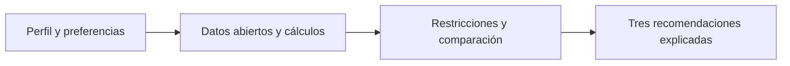
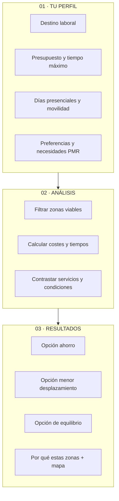
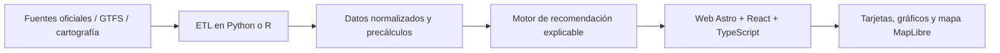

# MADRID A TU MEDIDA

### ¿Y si pudieras descubrir dónde vivir según cómo quieres vivir?

**Sistema de recomendación residencial personalizado · DATAMAD 2026**

*Una propuesta para transformar datos abiertos de la Comunidad de Madrid en decisiones residenciales comprensibles, adaptadas y justificadas.*

**Estado:** propuesta de proyecto · **Ámbito:** Comunidad de Madrid · **Formato previsto:** aplicación web interactiva

---

## El problema

Elegir dónde vivir no depende únicamente del precio del alquiler. También importan las horas que dedicamos a desplazarnos, la accesibilidad a servicios, el entorno y nuestras necesidades particulares. Sin embargo, esta información suele estar dispersa entre distintas fuentes y resulta difícil de comparar.

**Madrid a tu medida** propone invertir el proceso habitual de búsqueda: en lugar de pedir a una persona que elija primero un municipio, **el sistema le recomienda zonas residenciales a partir de su perfil y sus prioridades**.

## ¿Cómo funciona?

**01 · Cuéntanos cómo vives** → **02 · Analizamos las alternativas** → **03 · Descubre tus tres zonas recomendadas**

### Datos de entrada y resultados

| **El usuario introduce (inputs)** | **La aplicación devuelve (outputs)** |
|---|---|
| Destino habitual de trabajo o estudio | Tres zonas recomendadas y explicación de cada elección |
| Presupuesto máximo mensual de alquiler | Alquiler estimado de una vivienda comparable |
| Tiempo máximo de desplazamiento por trayecto | Minutos por trayecto y horas mensuales de transporte |
| Días presenciales y medio de transporte | Coste mensual estimado de transporte y gasto conjunto |
| Preferencias: sanidad, naturaleza, educación, cultura | Accesibilidad a servicios relevantes y mapa comparativo |
| Preferencia por calidad ambiental | Indicadores ambientales con fecha y cobertura |
| Necesidades de movilidad reducida (opcional) | Indicadores de accesibilidad PMR **solo donde existan datos verificables** |
| Interés por la seguridad de la zona (opcional) | Contexto de seguridad territorial **solo si hay datos comparables** |

El salario no es obligatorio. La aplicación no solicita una zona residencial de partida: **encontrarla es su propósito**.

## Experiencia de usuario prevista

| Pantalla | Objetivo | Interacción principal |
|---|---|---|
| **1. Tu perfil** | Conocer necesidades y límites | Formulario visual, selectores y prioridades |
| **2. Buscando tu lugar** | Mostrar el proceso de comparación | Transición animada honesta, sin simular cálculos inexistentes |
| **3. Tus tres lugares** | Explicar recomendaciones | Tarjetas comparativas, indicadores y mapa interactivo |

> Los nombres «ahorro», «menor desplazamiento» y «equilibrio» describen posibles perfiles de resultados, **no tres ganadores garantizados**: si los datos o las restricciones no permiten tres opciones diferentes, la interfaz lo explicará.

## Metodología: recomendaciones explicables

1. **Integración de datos.** Unificar indicadores de vivienda, transporte y equipamientos a una unidad territorial comparable (municipio o zona, según cobertura).
2. **Estimación comparable.** Calcular el alquiler de una vivienda de superficie de referencia, identificando año, fuente y límites de la estimación.
3. **Movilidad personalizada.** Estimar desplazamientos hacia el destino elegido y horas mensuales según días presenciales. Los horarios planificados no equivalen a tiempos reales garantizados.
4. **Filtros personales.** Excluir alternativas que superen el presupuesto de alquiler o el tiempo máximo declarado.
5. **Optimización multicriterio.** Identificar alternativas no dominadas mediante una **frontera de Pareto** en gasto mensual (alquiler + transporte) y tiempo mensual de desplazamiento.
6. **Adaptación y explicación.** Contrastar las opciones viables con las preferencias sobre servicios y entorno; seleccionar hasta tres alternativas diferenciadas mediante criterios documentados y mostrar ventajas, inconvenientes y procedencia de cada indicador.

**No asignaremos un precio arbitrario al tiempo libre.** Mostraremos por separado gasto y horas, y opcionalmente los euros ahorrados por cada hora adicional de desplazamiento entre dos alternativas.

### Dos dimensiones de especial interés

**Seguridad de la zona.** Se estudiará la disponibilidad de estadísticas públicas oficiales con cobertura territorial, período y denominadores comparables. Si solo existen cifras municipales o agregadas, no se atribuirán a barrios o calles ni se elaborará un «índice de seguridad» ficticio. Se evitará equiparar datos de denuncias con riesgo individual.

**Accesibilidad para personas con movilidad reducida.** Se priorizarán datos verificables de estaciones y paradas accesibles, ascensores, itinerarios peatonales y acceso a equipamientos. Un posible indicador medirá la proporción de destinos alcanzables mediante rutas documentadas como accesibles. **La ausencia de datos no se interpretará como falta de accesibilidad**, ni se presentarán rutas como accesibles sin validación.

## Fuentes de datos previstas

| Dimensión | Fuente candidata | Uso previsto |
|---|---|---|
| Transporte | [Datos abiertos CRTM](https://datos.crtm.es/) | Red, horarios GTFS, zonas tarifarias y conexiones |
| Sanidad y educación | [Datos abiertos de la Comunidad de Madrid](https://datos.comunidad.madrid/catalogo/) | Localización y tipología de equipamientos |
| Calidad ambiental | [Catálogo de datos de la Comunidad de Madrid](https://datos.comunidad.madrid/catalogo/) | Series y estaciones de calidad del aire |
| Vivienda | [SERPAVI (MIVAU)](https://serpavi.mivau.gob.es/) y fuentes de alquiler reutilizables | Estimaciones de alquiler con año y metodología explícitos |
| Cartografía y movilidad peatonal | [OpenStreetMap](https://www.openstreetmap.org/) | Red espacial y distancias, sujeto a validación |
| Seguridad | Estadísticas oficiales **por verificar** | Indicadores contextuales solo si son comparables |
| Accesibilidad PMR | CRTM y otras fuentes públicas **por verificar** | Cobertura de infraestructura accesible |

**Compromiso DATAMAD:** incorporar efectivamente al menos un conjunto de datos del **catálogo oficial de la Comunidad de Madrid**, documentando su uso y transformación. Las fuentes son candidatas y se validarán por fecha, cobertura, licencia y granularidad antes de usarlas en resultados reales.

## Arquitectura técnica propuesta

- **Procesamiento:** Python/R, pandas/GeoPandas y formatos CSV/Parquet.
- **Movilidad:** datos GTFS y red peatonal; rutas precalculadas para destinos seleccionados cuando sea viable.
- **Motor:** filtros reproducibles, frontera de Pareto y reglas transparentes de selección.
- **Interfaz:** Astro + React + TypeScript; cartografía MapLibre y visualizaciones interactivas.
- **Despliegue previsto:** Vercel para la web; procesamiento pesado fuera del navegador.
- **Calidad:** pruebas con perfiles distintos, control de valores faltantes y trazabilidad de fuentes.

## Alcance y honestidad metodológica

Esta es una **propuesta en fase de diseño**, no una aplicación terminada. Las pantallas y ejemplos visuales son conceptuales. La cobertura de municipios, las fuentes de alquiler, la seguridad territorial y la accesibilidad PMR dependerán de la validación de los datos. Si una dimensión carece de información suficiente, se mostrará como **«dato no disponible»** y no afectará silenciosamente al resultado.

**Objetivo:** que cualquier persona pueda entender **por qué** se le recomienda un lugar y **qué compromisos** implica elegirlo.

---

**DATAMAD 2026 · Propuesta de Ana y Giulio**

*Los datos no deberían decirte cómo vivir. Deberían ayudarte a elegir.*

