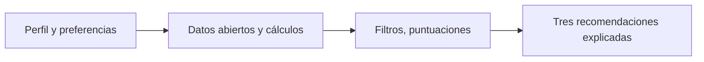
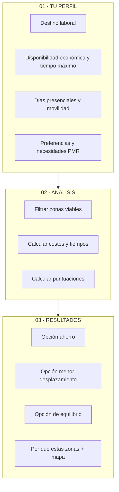
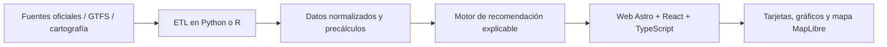

# MADRID A TU MEDIDA

### ¿Y si pudieras descubrir dónde vivir según cómo quieres vivir?

**Sistema de recomendación residencial personalizado · DATAMAD 2026**

*Una propuesta para transformar datos abiertos de la Comunidad de Madrid en decisiones residenciales comprensibles, adaptadas y justificadas.*

**Estado:** propuesta de proyecto · **Ámbito:** Comunidad de Madrid · **Formato previsto:** aplicación web interactiva

---

## El problema

Elegir dónde vivir no depende únicamente del precio del alquiler. También importan las horas que dedicamos a desplazarnos, la accesibilidad a servicios, el entorno y nuestras necesidades particulares. Sin embargo, esta información suele estar dispersa entre distintas fuentes y resulta difícil de comparar.

**Madrid a tu medida** propone invertir el proceso habitual de búsqueda: en lugar de pedir a una persona que elija primero un municipio, **el sistema le recomienda zonas residenciales a partir de su perfil y sus prioridades**.

## ¿Cómo funciona?

**01 · Cuéntanos cómo vives** → **02 · Analizamos las alternativas** → **03 · Descubre tus tres zonas recomendadas**

### Datos de entrada y resultados

Cada variable alimenta una puntuación de 0 a 100 por zona. La suma ponderada de las puntuaciones ordena las zonas y da lugar a las tres recomendaciones.

La aplicación devuelve:

- Tres zonas recomendadas, una por perfil, con su puntuación total y el desglose por criterio.
- El esfuerzo económico en cada zona, con el alquiler máximo y una referencia histórica: «Aquí el alquiler mediano y el abono supondrían el N % de tu disponibilidad económica. Para no pasar del 35 %, el anuncio no debería superar X €/mes. En 2024, la mitad de los alquileres de la zona estaba entre A y B € (mediana M).»
- Minutos por trayecto, horas mensuales de transporte y coste del abono.
- Los datos de cada zona, agregados y visualizados junto a la referencia de la Comunidad de Madrid.
- Un mapa comparativo de las tres zonas.

El dato económico es la **disponibilidad económica mensual**\* (salario neto o ingresos totales). Sobre esa cifra la aplicación calcula el esfuerzo económico de cada zona: la parte que supondrían el alquiler mediano y el abono de transporte.

\* Indica el dinero del que dispones al mes, no la cantidad que quieres destinar a la vivienda.

## Experiencia de usuario prevista

| Pantalla | Objetivo | Interacción principal |
|---|---|---|
| **1. Tu perfil** | Conocer necesidades y límites | Formulario visual, selectores y prioridades |
| **2. Buscando tu lugar** | Mostrar el proceso de comparación | Transición animada mientras se calculan las zonas |
| **3. Tus tres lugares** | Explicar recomendaciones | Tarjetas comparativas, indicadores y mapa interactivo |

> Las tres opciones son tres repartos de pesos sobre las mismas puntuaciones (ver Metodología). Si dos repartos señalan la misma zona, se muestra la siguiente mejor.

## Metodología: recomendaciones explicables
1. **Integración de datos.** Unificar indicadores de vivienda, transporte y equipamientos a una unidad territorial comparable (municipio o zona, según cobertura).
2. **Esfuerzo económico.** Para cada zona se calcula qué parte de la disponibilidad económica mensual supondrían el alquiler mediano de la zona (SERPAVI 2024, último año disponible) y el abono de transporte que le corresponde. Ese porcentaje se convierte en puntuación con una escala lineal por tramos, en la que 100 corresponde al esfuerzo más bajo:

   | Esfuerzo económico | Puntuación |
   |---|---|
   | Hasta el 25 % | 100 |
   | 75 % | 10 |
   | 100 % o más | 0 |

   Entre esos puntos la puntuación baja de forma lineal: un esfuerzo del 35 % da 82 puntos y uno del 50 %, 55. Los umbrales son provisionales. Junto al porcentaje se muestra el alquiler máximo para no pasar del 35 %: el 35 % de la disponibilidad económica menos el abono de la zona. Se pide la disponibilidad económica y no un presupuesto de vivienda: esta herramienta resuelve el paso anterior a la búsqueda del anuncio, es decir, qué parte de tu disponibilidad económica se llevarían la vivienda y el transporte en cada zona.
3. **Desplazamiento.** Tiempo de trayecto en transporte público hasta el destino indicado, a partir de los horarios GTFS del CRTM, y horas mensuales según los días presenciales. La puntuación es 100 hasta 15 minutos puerta a puerta y baja de forma lineal hasta 0 en el tiempo máximo indicado. El umbral adapta al transporte público el de la ciudad de los 15 minutos (Moreno et al., 2021), formulado para trayectos a pie o en bicicleta.
4. **Filtro previo.** Quedan fuera las zonas que superan el tiempo máximo indicado. No hay filtro económico: una zona cara conserva su puntuación baja y su porcentaje de esfuerzo se muestra siempre junto al resultado.
5. **Preferencias.** Cada preferencia marcada genera su propia puntuación de 0 a 100: sanidad, educación, cultura, naturaleza y edad de los vecinos. Para los servicios se usa el número de equipamientos por habitante, convertido en posición percentil entre zonas. Para la edad, el usuario elige un perfil (jóvenes, familias, mayores) y la puntuación refleja el peso de esa franja entre los residentes.
6. **Puntuación total y tres perfiles.** La puntuación total de cada zona es la suma ponderada de sus puntuaciones. Las tres zonas recomendadas responden a tres repartos de pesos:

   | Perfil | Esfuerzo económico | Desplazamiento | Preferencias |
   |---|---|---|---|
   | Equilibrio | 38 % | 34 % | 28 % |
   | Ahorro | 50 % | 28 % | 22 % |
   | Menor desplazamiento | 32 % | 46 % | 22 % |

   El peso de preferencias se reparte a partes iguales entre las que el usuario haya marcado. Si no marca ninguna, ese peso se reparte entre esfuerzo económico y desplazamiento. Los pesos son provisionales.

   Los pesos expresan cuánto cuenta cada criterio en cada perfil y se muestran junto al resultado.
7. **Visualización.** Los datos que explican cada recomendación se agregan por zona y se muestran de forma visual junto a la referencia de la Comunidad de Madrid. El tipo de gráfico se definirá durante el desarrollo.

Ejemplo ilustrativo (cifras inventadas). Una persona marca sanidad y naturaleza. Para una zona, con el perfil «equilibrio»:

| Puntuación | Valor | Peso |
|---|---|---|
| Esfuerzo económico | 72 | 38 % |
| Desplazamiento | 58 | 34 % |
| Sanidad | 80 | 14 % |
| Naturaleza | 40 | 14 % |
| **Total** | **63,9** | 100 % |

**Referencia.** Moreno, C., Allam, Z., Chabaud, D., Gall, C. y Pratlong, F. (2021). Introducing the «15-Minute City»: Sustainability, Resilience and Place Identity in Future Post-Pandemic Cities. *Smart Cities*, 4(1), 93–111. https://doi.org/10.3390/smartcities4010006

### Dos dimensiones de especial interés

**Seguridad de la zona.** Se estudiará la disponibilidad de estadísticas públicas oficiales con cobertura territorial, período y denominadores comparables. Si solo existen cifras municipales o agregadas, no se atribuirán a barrios o calles ni se elaborará un «índice de seguridad» ficticio. Se evitará equiparar datos de denuncias con riesgo individual.

**Accesibilidad para personas con movilidad reducida.** Se priorizarán datos verificables de estaciones y paradas accesibles, ascensores, itinerarios peatonales y acceso a equipamientos. Un posible indicador medirá la proporción de destinos alcanzables mediante rutas documentadas como accesibles. **La ausencia de datos no se interpretará como falta de accesibilidad**, ni se presentarán rutas como accesibles sin validación.

| Puntuación | Fuente | Publica |
|---|---|---|
| Asequibilidad | [SERPAVI, alquileres declarados 2011–2024](https://www.mivau.gob.es/vivienda/alquila-bien-es-tu-derecho/serpavi) | Ministerio de Vivienda |
| Asequibilidad | [Tarifas del Abono 30 días por zona](https://crtm.es/billetes-y-tarifas/buscador/abono-30-dias/) | CRTM |
| Desplazamiento | Horarios GTFS (metro, cercanías, EMT, interurbanos) | CRTM |
| Desplazamiento | [Infraestructura de transporte público](https://datos.comunidad.madrid/catalogos/#/dataset/infraestructura_transporte_publico?view=info) | Catálogo CM |
| Desplazamiento | Callejero `numeracion_vigente_datos_abiertos` (geocodificación del destino, solo Madrid capital) | Catálogo CM |
| Sanidad | [Centros, servicios y establecimientos sanitarios](https://datos.comunidad.madrid/catalogos/#/dataset/centros_servicios_establecimientos_sanitarios?view=info) | Catálogo CM |
| Sanidad | [Oficinas de farmacia](https://datos.comunidad.madrid/catalogo/dataset/oficinas_farmacia) | Catálogo CM |
| Educación | [Centros educativos](https://datos.comunidad.madrid/catalogos/#/dataset/centros_educativos?view=info) | Catálogo CM |
| Cultura | [Centros y servicios bibliotecarios](https://datos.comunidad.madrid/catalogos/#/dataset/centros_servicios_bibliotecarios_dependientes_cm_ayuntamiento_madrid?view=info) | Catálogo CM |
| Cultura | [Patrimonio cultural protegido](https://datos.gob.es/es/catalogo/a13002908-patrimonio-cultural-protegido-en-la-comunidad-de-madrid) | Catálogo CM |
| Naturaleza | [Red Natura 2000, ZEPA](https://datos.gob.es/es/catalogo/a13002908-red-natura-2000-zonas-de-especial-proteccion-para-las-aves-zepa_es30) y [LIC/ZEC](https://datos.gob.es/es/catalogo/a13002908-red-natura-2000-lugares-de-importancia-comunitaria-y-zonas-especiales-de-conservacion-lic_es30) | Catálogo CM |
| Edad de los vecinos | [Residentes por rango de edad](https://datos.gob.es/es/catalogo/a13002908-residentes-en-la-comunidad-de-madrid-por-rango-de-edad1) | Catálogo CM |
| Accesibilidad PMR | Horarios GTFS, campo de accesibilidad de las paradas | CRTM |
| Accesibilidad PMR | [Madrid Accesible](https://www.madridaccesible.com/datos), fuente candidata por validar | Por validar |
| Seguridad (contexto, sin puntuación) | [Delincuencia y victimización en la Comunidad de Madrid](https://datos.gob.es/es/catalogo/ea0040772-delincuencia-y-victimizacion-en-la-comunidad-de-madrid) | datos.gob.es |
| Base cartográfica | [Municipios de la Comunidad de Madrid](https://datos.gob.es/es/catalogo/a13002908-municipios-de-la-comunidad-de-madrid1) | Catálogo CM |

**Compromiso DATAMAD:** incorporar efectivamente al menos un conjunto de datos del **catálogo oficial de la Comunidad de Madrid**, documentando su uso y transformación. Las fuentes son candidatas y se validarán por fecha, cobertura, licencia y granularidad antes de usarlas en resultados reales.

## Arquitectura técnica propuesta

- **Procesamiento:** Python/R, pandas/GeoPandas y formatos CSV/Parquet.
- **Movilidad:** datos GTFS y red peatonal; rutas precalculadas para destinos seleccionados cuando sea viable.
- **Motor:** filtros reproducibles, frontera de Pareto y reglas transparentes de selección.
- **Interfaz:** Astro + React + TypeScript; cartografía MapLibre y visualizaciones interactivas.
- **Despliegue previsto:** Vercel para la web; procesamiento pesado fuera del navegador.
- **Calidad:** pruebas con perfiles distintos, control de valores faltantes y trazabilidad de fuentes.

## Alcance y honestidad metodológica

Esta es una **propuesta en fase de diseño**, no una aplicación terminada. Las pantallas y ejemplos visuales son conceptuales. La cobertura de municipios, las fuentes de alquiler, la seguridad territorial y la accesibilidad PMR dependerán de la validación de los datos. Si una dimensión carece de información suficiente, se mostrará como **«dato no disponible»** y no afectará silenciosamente al resultado.

**Objetivo:** que cualquier persona pueda entender **por qué** se le recomienda un lugar y **qué compromisos** implica elegirlo.

---

**DATAMAD 2026 · Propuesta de Ana y Giulio**

*Los datos no deberían decirte cómo vivir. Deberían ayudarte a elegir.*

